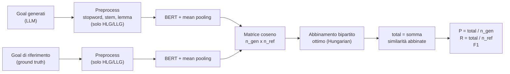
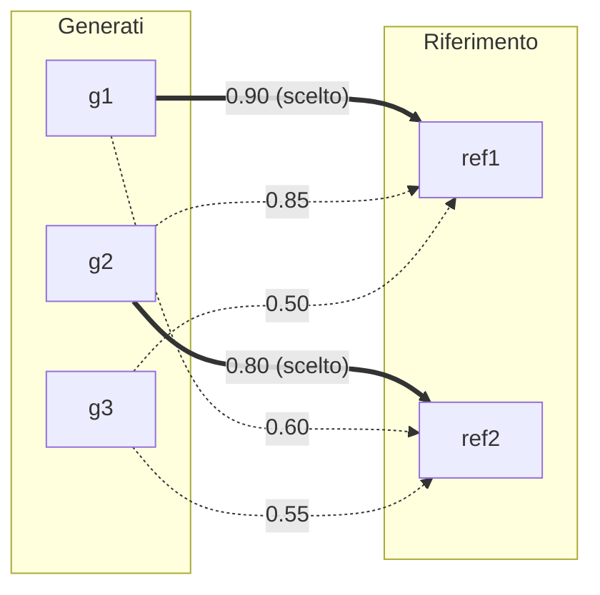
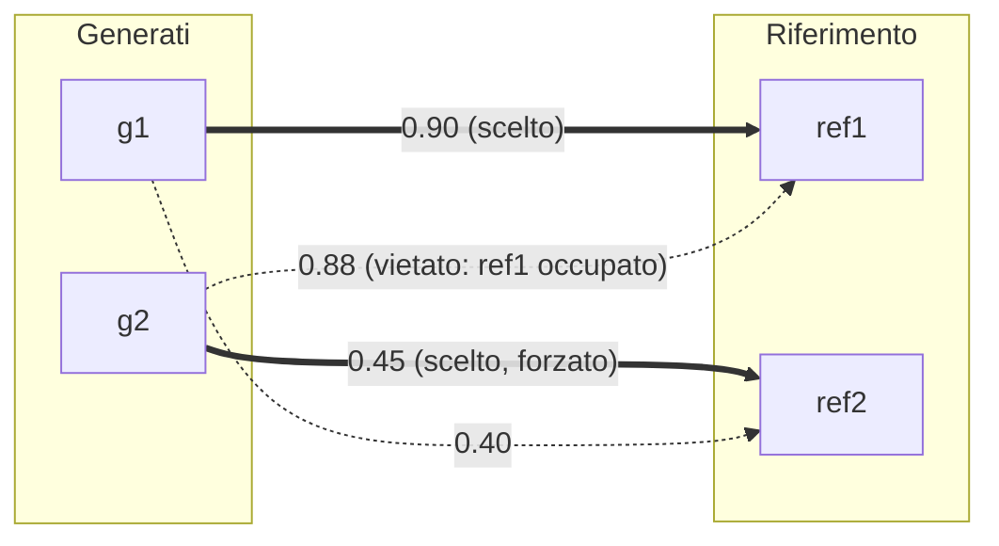
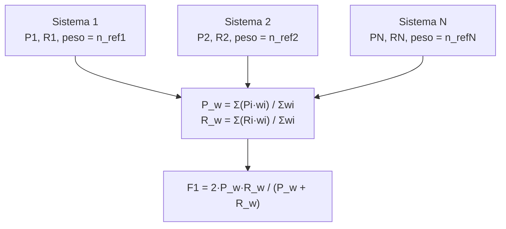
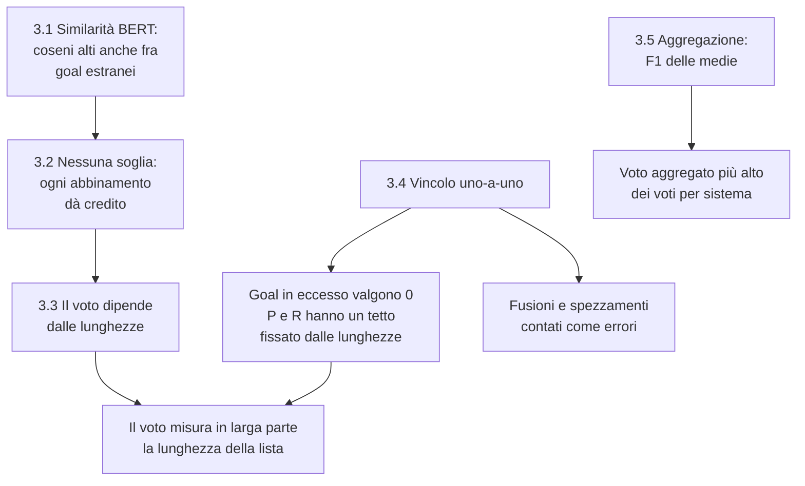
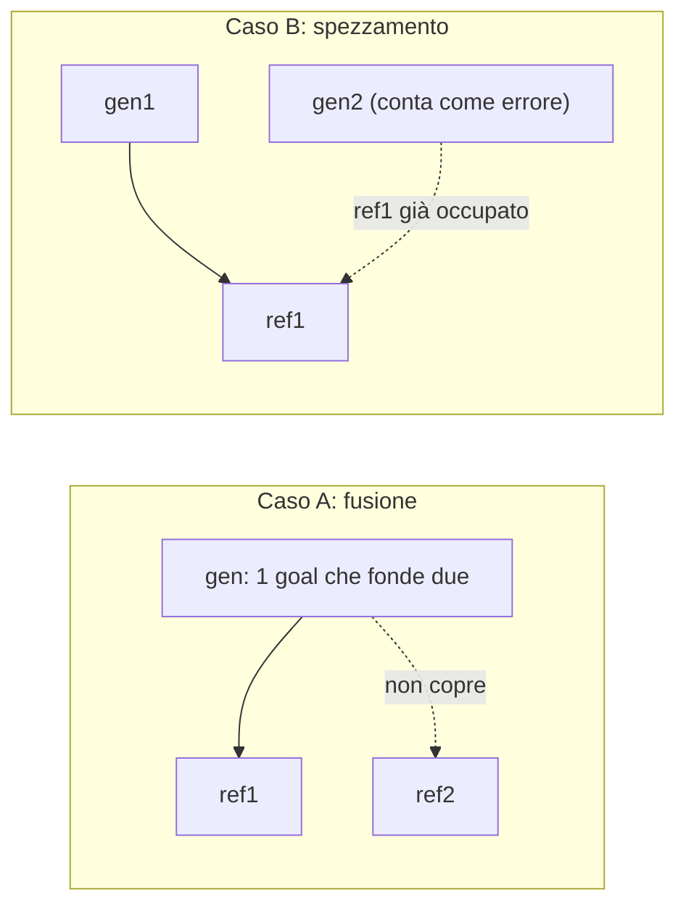
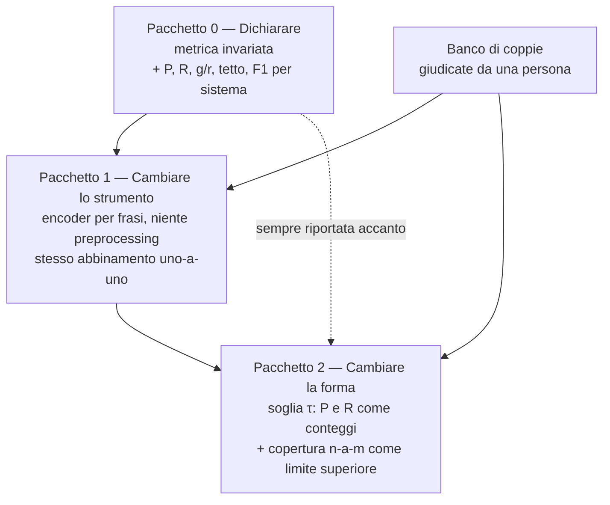

# Metrica di valutazione: grafo bipartito (soft F1)

> **Data:** 2026-10-12
>
> **Breve descrizione:** come funziona la metrica usata dal progetto (similarità BERT più abbinamento bipartito ottimo), quali problemi ha, quanto pesano sui dati della campagna 2 e quali soluzioni sono possibili. Tutte le misure sono state ricalcolate il 2026-10-12 sui 12 sistemi della ground truth finale e sulle tre repliche della baseline.

**Codice di riferimento:** `src/evaluation/goal_evaluator.py` (classe `GoalEvaluator`), chiamata dal notebook.

**Come leggere i numeri di questo documento.** Ci sono due tipi di numeri, sempre etichettati:

- **«Esempio inventato»**: numeri scelti a mano per mostrare un calcolo. Non sono risultati.
- **«Misurato»**: numeri ottenuti con `src/diagnostics/metric_diagnostics.py` sugli output già su disco (metodo al § 2). Descrivono il *comportamento del metro*, non la qualità della pipeline: non sono soglie né bersagli per gli esperimenti.

---

## 0. Sintesi

**Cosa fa la metrica.** Trasforma ogni goal in un vettore con BERT, calcola la somiglianza (coseno) fra ogni goal generato e ogni goal di riferimento, sceglie l'abbinamento uno-a-uno che massimizza la somma delle somiglianze e divide quella somma per il numero di goal generati (precision) e di riferimento (recall).

**Il giudizio in una riga.** Il grafo bipartito, come *meccanismo di abbinamento*, è corretto e robusto. Il problema sta in ciò che gli viene dato da abbinare (i pesi) e in come il risultato viene trasformato in un voto.

**I quattro problemi principali, misurati sui 12 sistemi:**

| # | Problema | Evidenza misurata |
|---|---|---|
| 1 | La somiglianza BERT distingue poco un goal pertinente da uno estraneo | La lista di LLG generata per un sistema, punteggiata contro la ground truth di **un altro sistema**, ottiene in media F1 **0.45**; contro la ground truth giusta **0.52** |
| 2 | Nessuna soglia: ogni abbinamento, anche forzato, dà credito | Il 99% di *tutte* le coppie generato–riferimento vale più di quanto basta per far salire l'F1 |
| 3 | Il voto dipende dalle lunghezze delle due liste | La pipeline genera in media 2.4 LLG e 2.6 HLG per ogni goal di riferimento. Con queste lunghezze l'F1 ha un tetto ben sotto 1 anche con abbinamenti perfetti: per gli LLG di *London Ambulance Service* il tetto è 0.19 e l'F1 misurato 0.14 |
| 4 | Il vincolo uno-a-uno scarta molti goal generati | Il 58% degli HLG e il 45% degli LLG generati resta senza partner e vale zero |

**Problemi minori, confermati:** l'F1 aggregato del codice è sempre più alto della media degli F1 per sistema (da +0.03 a +0.07); il preprocessing peggiora la separazione su HLG e LLG; cinque difetti nel codice (§ 3.7).

**Cosa si propone** (§ 4): tre pacchetti combinabili, dal meno al più invasivo. *Dichiarare*: riportare precision, recall, rapporto fra le lunghezze e tetto accanto all'F1. *Cambiare lo strumento*: un encoder addestrato a confrontare frasi al posto di BERT grezzo. *Cambiare la forma*: soglia e copertura n-a-m. La metrica attuale resta comunque riportata accanto, mai sostituita in silenzio.

**Cosa resta da decidere** (§ 5): quale encoder e quale soglia. Entrambe richiedono un banco di coppie giudicate da una persona; nessuna misura automatica può sostituirlo.

---

## 1. Come funziona la metrica

### 1.1 I passi

Per ogni sistema (dataset) e per ogni categoria (attori, HLG, LLG) confronta due liste: i goal generati dal LLM e i goal della ground truth.

1. **Pulizia del testo** (solo HLG/LLG): rimozione stopword, stemming, lemmatizzazione. Per gli attori no (`preprocess=False`).
2. **Embedding:** ogni goal diventa un vettore con `bert-base-uncased`, facendo la media dei vettori dei token (mean pooling).
3. **Matrice di similarità:** coseno tra ogni goal generato e ogni goal di riferimento (righe = generati, colonne = riferimento).
4. **Grafo bipartito:** i generati sono un lato, i riferimento l'altro; ogni coppia è un arco pesato con la similarità. `linear_sum_assignment` (algoritmo ungherese) trova l'abbinamento uno-a-uno che **massimizza la somma dei pesi**.
5. **Punteggio:**
   - `total` = somma delle similarità degli archi scelti
   - `precision = total / n_generati`
   - `recall = total / n_riferimento`
   - `F1` = media armonica di precision e recall



### 1.2 Il grafo bipartito su un esempio

Esempio inventato: 3 goal generati, 2 di riferimento.

| | ref1 | ref2 |
|---|---|---|
| g1 | 0.90 | 0.60 |
| g2 | 0.85 | 0.80 |
| g3 | 0.50 | 0.55 |



Abbinamento ottimo: g1↔ref1 e g2↔ref2, somma 0.90 + 0.80 = **1.70**. g3 resta senza partner.

- precision = 1.70 / 3 = **0.567**
- recall = 1.70 / 2 = **0.85**
- F1 = 2 · 0.567 · 0.85 / (0.567 + 0.85) ≈ **0.68**

Un goal generato in più, non abbinato, abbassa la precision. Un goal di riferimento mancato abbassa la recall. Nessuna soglia coinvolta.

L'arco g2→ref1 (0.85) è più alto di g2→ref2 (0.80), ma l'ottimo globale preferisce g1→ref1 + g2→ref2 (1.70) a g2→ref1 + g1→ref2 (1.45). L'algoritmo ottimizza la somma totale, non le scelte locali: può quindi preferire due abbinamenti medi a uno ottimo più uno nullo.

### 1.3 Il vincolo uno-a-uno

`linear_sum_assignment` produce un abbinamento (matching) uno-a-uno: ogni goal generato è collegato al massimo a un riferimento e viceversa. Più goal generati **non possono** puntare allo stesso riferimento. Con matrice rettangolare gli abbinamenti sono esattamente `min(n_gen, n_ref)`.

Esempio inventato: g1 e g2 sono entrambi molto simili a ref1.

| | ref1 | ref2 |
|---|---|---|
| g1 | 0.90 | 0.40 |
| g2 | 0.88 | 0.45 |



- Abbinamento A: g1↔ref1 + g2↔ref2 = 0.90 + 0.45 = **1.35** (vince)
- Abbinamento B: g2↔ref1 + g1↔ref2 = 0.88 + 0.40 = 1.28

Conseguenze:

- Il duplicato non viene premiato due volte: o prende il posto di un abbinamento peggiore (come g2 qui), o resta senza partner.
- Se i generati sono più dei riferimenti, quelli in eccesso valgono 0 nel numeratore (`total`) ma contano nel denominatore della precision.
- Se i riferimenti sono più dei generati, quelli scoperti abbassano la recall allo stesso modo.

### 1.4 Cosa significano P, R e F1 in questa metrica

- **P (precision):** dei goal generati, quanta parte è "giusta". Qui `P = total / n_gen`.
- **R (recall):** dei goal della ground truth, quanta parte è stata trovata. Qui `R = total / n_ref`.
- **F1:** media *armonica* di P e R, `F1 = 2PR / (P + R)`. Si usa l'armonica perché punisce gli squilibri: con P = 1 e R = 0.1 la media aritmetica darebbe 0.55, l'armonica 0.18.

`total` è una somma di similarità, non un conteggio di goal giusti: per questo la metrica è "soft". Nella definizione classica al numeratore c'è il numero di veri positivi (TP), cioè un conteggio.

Scrivendo `P = T/g` e `R = T/r` (T = total, g = n_gen, r = n_ref) l'F1 si semplifica in:

**`F1 = 2T / (g + r)`**

Verifica sull'esempio del § 1.2: T = 1.70, g = 3, r = 2 → 3.40 / 5 = 0.68, uguale al calcolo diretto. Questa forma è la chiave per capire i problemi dei § 3.2 e 3.3: il voto è una somma di somiglianze divisa per la lunghezza totale delle due liste.

### 1.5 Aggregazione tra sistemi

`print_prec_rec_curve` aggrega i sistemi con una **media pesata sul numero di goal di riferimento** di ciascuno, poi calcola l'F1 sulle medie pesate di P e R. Non è la media degli F1 per sistema.

Con `rate_table=True` costruisce anche una curva P/R: per ogni soglia τ da 0 a 1 (101 punti) conta quanti archi scelti hanno similarità ≥ τ, e ne calcola l'AUC. P, R e F1 principali non usano però alcuna soglia.



### 1.6 A cosa serve, e cosa fa bene

Metrica "soft": confronta il significato dei goal e non la stringa esatta. Il bipartito evita che un solo goal di riferimento venga "coperto" da molti goal generati simili; senza l'abbinamento uno-a-uno la precision verrebbe gonfiata dai duplicati.

Come meccanismo di abbinamento è solido:

- **ottimo globale**: nessun altro abbinamento uno-a-uno ha somma più alta;
- **simmetrico**: tratta allo stesso modo generati e riferimenti;
- **deterministico**: due chiamate sugli stessi input danno matrici identiche (misurato: differenza massima 0.0);
- **algoritmo standard**, implementazione di libreria.

Il grafo decide però solo *chi* si abbina con *chi*. Quanto vale ogni abbinamento lo decide la funzione di similarità, e come quel valore diventa un voto lo decide la formula. I problemi stanno lì.

---

## 2. Come sono stati verificati i fatti

Tutte le misure vengono da un solo script, `src/diagnostics/metric_diagnostics.py`, che non chiama nessun LLM e non modifica nessun file esistente. Lo script viene dal pilota ed è stato adattato alla campagna 2; la definizione delle misure è nel registro `artifacts/research/analisi/analisi-fase-3.md`, analisi B1, scritta prima del calcolo.

| | |
|---|---|
| **Output analizzati** | `artifacts/results/exp_01_baseline/exp_01_baseline_r1`, `_r2`, `_r3`: 12 sistemi × 3 shot mode × 2 bracci del critico × 3 repliche = **216 liste per tipo di lista** |
| **Ground truth** | `notebook/groundtruth.py`, la ground truth finale a 12 sistemi |
| **Risultati grezzi** | `artifacts/results/exp_01_baseline_metric/exp_01_baseline_metric_diagnostics/metric_diagnostics.json` |
| **Controllo di correttezza** | L'F1 ricalcolato dallo script coincide con quello dei CSV scritti dal notebook a meno di 1.8·10⁻⁷, su tutte le liste delle tre repliche |

Comando, dalla radice del repository:

```bash
python src/diagnostics/metric_diagnostics.py \
  --runs artifacts/results/exp_01_baseline/exp_01_baseline_r1 \
         artifacts/results/exp_01_baseline/exp_01_baseline_r2 \
         artifacts/results/exp_01_baseline/exp_01_baseline_r3 \
  --output artifacts/results/exp_01_baseline_metric/exp_01_baseline_metric_diagnostics/metric_diagnostics.json
```

**L'idea centrale: il confronto incrociato fra sistemi.** Per sapere quanto vale una somiglianza "a vuoto" si punteggia la lista generata per un sistema contro la ground truth di *un altro* sistema (per esempio i goal dell'ospedale contro quelli del genoma). Sono liste che non hanno nulla da dirsi per costruzione, quindi il punteggio che ottengono è ciò che la metrica assegna in assenza di corrispondenza reale.

Lo stesso confronto è ripetuto con quattro strumenti, per separare ciò che dipende da BERT da ciò che dipende dalla forma del punteggio:

| Sigla | Encoder | Dove è in uso |
|---|---|---|
| BERT+pre | `bert-base-uncased`, mean pooling, con preprocessing | **In uso per HLG e LLG** |
| BERT | `bert-base-uncased`, mean pooling, testo originale | **In uso per gli attori** |
| MiniLM | `all-MiniLM-L6-v2` (sentence encoder), testo originale | Non in uso |
| MPNet | `all-mpnet-base-v2` (sentence encoder), testo originale | Non in uso |

I due sentence encoder servono solo da termine di paragone: non sono candidati scelti.

**Due cose diverse che si possono chiamare "rumore".** La Fase 2 ha misurato quanto cambia l'F1 fra due esecuzioni identiche della pipeline (rumore *fra repliche*). Il confronto incrociato misura un'altra cosa: quanto punteggio la metrica assegna a liste estranee (rumore *della similarità*). Il primo dice quanto deve essere grande una differenza per essere creduta; il secondo dice quanta parte del voto non dipende dal contenuto.

**Limiti del metodo**, da dichiarare:

- Il confronto incrociato è una stima *per eccesso* del punteggio a vuoto: due sistemi diversi possono avere goal legittimamente simili (autenticazione, gestione utenti) e attori generici in comune ("User", "Administrator"). Cinque dei 12 sistemi sono progetti dello stesso corso e hanno description di forma simile.
- Le coppie "abbinate" non sono tutte corrispondenze vere: includono gli abbinamenti forzati. Nessuna misura qui usa un giudizio umano.
- I dati sono gli output della baseline. Dicono come si comporta il metro su questo materiale.

---

## 3. I problemi

Sono ordinati per gravità. I primi quattro sono collegati fra loro; lo schema mostra come.



### 3.1 La similarità BERT distingue poco un goal pertinente da uno estraneo

**Il problema.** `bert-base-uncased` con mean pooling non è stato addestrato a confrontare frasi. I suoi coseni stanno tutti in una fascia alta e stretta, qualunque cosa si confronti. L'abbinamento riesce ancora a ordinare gli archi, ma i pesi che poi vengono sommati dicono poco.

**Misurato — dove stanno i coseni** (strumento in uso per ciascun tipo di lista):

| Lista | Coppie abbinate (media) | Tutte le coppie, stesso sistema (media) | Tutte le coppie, **sistemi diversi** (media) | Sistemi diversi, 95° percentile |
|---|---|---|---|---|
| Attori | 0.92 | 0.74 | 0.68 | 0.85 |
| HLG | 0.71 | 0.64 | 0.61 | 0.74 |
| LLG | 0.74 | 0.65 | 0.62 | 0.75 |

*Come leggerla:* riga LLG. Una coppia abbinata vale in media 0.74. Una coppia presa a caso fra un goal generato e un riferimento di **un altro sistema** vale 0.62, e una su venti supera 0.75, cioè più della media delle coppie abbinate.

**Misurato — il punteggio di una lista estranea:**

| Lista | F1 medio, ground truth **giusta** | F1 medio, ground truth di **un altro sistema** |
|---|---|---|
| Attori | 0.79 | 0.52 |
| HLG | 0.44 | 0.39 |
| LLG | 0.52 | 0.45 |

*Cosa significa:* per HLG e LLG una lista che parla di un altro sistema ottiene quasi nove decimi del voto della lista giusta. Il confronto non è perfettamente alla pari, perché cambiando ground truth cambia anche il numero di riferimenti (e il voto dipende dalle lunghezze, § 3.3); ma indica che una parte grande del voto è indipendente dal contenuto.

**Misurato — con un sentence encoder la separazione c'è.** Le due colonne "separazione" sono la probabilità che una coppia abbinata abbia coseno più alto di una coppia fra sistemi diversi (0.5 = a caso, 1 = sempre). La prima confronta le coppie abbinate con *tutte* le coppie fra sistemi diversi. La seconda le confronta con le sole coppie *abbinate* nel confronto fra sistemi diversi: è il confronto alla pari, perché in entrambi i casi l'abbinamento ha scelto le coppie migliori.

| Lista | Encoder | Coppie abbinate | Sistemi diversi | Separazione (tutte) | Separazione (alla pari) | F1 giusta | F1 altro sistema |
|---|---|---|---|---|---|---|---|
| HLG | BERT+pre (in uso) | 0.71 | 0.61 | 0.80 | 0.66 | 0.44 | 0.39 |
| HLG | BERT | 0.67 | 0.54 | 0.84 | 0.76 | 0.41 | 0.34 |
| HLG | MiniLM | 0.59 | 0.11 | 0.99 | 0.98 | 0.37 | 0.11 |
| HLG | MPNet | 0.59 | 0.13 | 0.99 | 0.97 | 0.37 | 0.12 |
| LLG | BERT+pre (in uso) | 0.74 | 0.62 | 0.86 | 0.67 | 0.52 | 0.45 |
| LLG | BERT | 0.71 | 0.57 | 0.89 | 0.76 | 0.49 | 0.41 |
| LLG | MiniLM | 0.56 | 0.09 | 0.99 | 0.95 | 0.38 | 0.14 |
| LLG | MPNet | 0.55 | 0.09 | 0.99 | 0.95 | 0.38 | 0.14 |
| Attori | BERT (in uso) | 0.92 | 0.68 | 0.92 | 0.84 | 0.79 | 0.52 |
| Attori | MiniLM | 0.88 | 0.28 | 0.97 | 0.93 | 0.76 | 0.27 |
| Attori | MPNet | 0.87 | 0.31 | 0.96 | 0.91 | 0.75 | 0.29 |

*Cosa significa:* nel confronto alla pari lo strumento in uso separa due volte su tre (0.66–0.67), poco sopra il caso. Con i sentence encoder una coppia estranea vale circa 0.1 sui goal, non 0.6, e la separazione è quasi completa. I voti assoluti scendono (LLG da 0.52 a 0.38) proprio perché sparisce la quota che non dipendeva dal contenuto.

**Cosa questa misura non dice.** Dice che i sentence encoder separano il pertinente dall'estraneo; non dice che siano d'accordo con un esaminatore su «questi due goal sono lo stesso goal?». Separare sistemi diversi è una condizione necessaria, non sufficiente.

### 3.2 Nessuna soglia: ogni abbinamento, anche forzato, dà credito

**Il problema.** Ogni riferimento ottiene un partner anche se pessimo, e quel partner contribuisce al voto con il suo valore. Un abbinamento a 0.70 conta 0.70 anche se i due goal parlano di cose diverse.

Esempio inventato: 3 generati, 3 riferimento, solo uno è una vera corrispondenza. Coseni degli archi scelti: 0.90, 0.70, 0.70.

| Metodo | Numeratore | P = R |
|---|---|---|
| Attuale (somma continua) | 0.90 + 0.70 + 0.70 = 2.30 | 2.30 / 3 = **0.77** |
| Soglia τ = 0.8 (conteggio) | 1 coppia sopra soglia | 1 / 3 = **0.33** |

Il punteggio attuale misura "quanto sono simili in media", non "quanti goal ho trovato".

**Perché è grave insieme al § 3.1.** Se le coppie estranee valessero 0, l'assenza di soglia sarebbe innocua: un abbinamento forzato porterebbe zero. Con BERT un abbinamento forzato porta circa 0.6. I due problemi si moltiplicano.

**Problema correlato, confermato: la curva precision/recall del codice sottostima.** La `rate_table` applica la soglia *dopo* aver scelto l'abbinamento che massimizza la somma. Ma l'abbinamento che massimizza la somma non è quello che massimizza il *numero* di coppie sopra soglia. Misurato sugli LLG, strumento in uso:

| τ | Coppie ≥ τ nell'abbinamento del codice | Massimo numero di coppie ≥ τ abbinabili uno-a-uno | Liste in cui differiscono (su 216) |
|---|---|---|---|
| 0.70 | 3 340 | 3 500 | 94 |
| 0.80 | 1 294 | 1 440 | 91 |
| 0.85 | 364 | 424 | 46 |

Se si introduce una soglia, il conteggio va fatto con un abbinamento calcolato sul grafo già tagliato, non riusando quello attuale.

### 3.3 Il voto dipende dalle lunghezze delle due liste

Dalla forma `F1 = 2T / (g + r)` (§ 1.4) discendono due effetti. Quale dei due agisce dipende da quale lista è più lunga.

**Misurato — in quale regime sta la pipeline** (su 216 liste per tipo):

| Lista | Generati meno dei riferimenti | Uguali | Generati più dei riferimenti | Rapporto g/r medio (min – max) |
|---|---|---|---|---|
| Attori | 18 | 102 | 96 | 1.41 (0.75 – 4.00) |
| HLG | 0 | 5 | 211 | 2.61 (1.00 – 8.75) |
| LLG | 22 | 2 | 192 | 2.44 (0.50 – 13.50) |

La pipeline genera quasi sempre più goal di quanti ce ne siano nella ground truth. Il regime dominante è quindi il primo dei due descritti sotto.

**Effetto 1 — quando i generati sono più dei riferimenti, il voto ha un tetto.** Gli abbinamenti sono al massimo `min(g, r)` e ognuno vale al massimo 1. Quindi `P ≤ r/g`, e l'F1 non può superare `2·min(g, r) / (g + r)`, *qualunque sia la qualità dei goal*.

Due liste reali (LLG, zero esempi, critico acceso, replica 1):

| Sistema | g | r | Tetto della precision | Precision misurata | Recall misurata |
|---|---|---|---|---|---|
| *Assegno Unico Universale* | 118 | 28 | 28/118 = 0.24 | 0.19 | 0.82 |
| *London Ambulance Service* | 23 | 2 | 2/23 = 0.09 | 0.07 | 0.80 |

**Misurato — tetto e voto per sistema** (LLG, media sulle 18 liste di ogni sistema):

| Sistema | Riferimenti | Generati (media) | Tetto dell'F1 | F1 misurato |
|---|---|---|---|---|
| *Planning Poker* | 33 | 40.6 | 0.89 | 0.64 |
| *SIA Project 25 26* | 31 | 38.8 | 0.86 | 0.64 |
| *Genome Nexus* | 30 | 24.5 | 0.85 | 0.69 |
| *Gestao Hospital* | 18 | 27.1 | 0.81 | 0.59 |
| *Calculator* | 7 | 10.7 | 0.80 | 0.57 |
| *Event Organization Portal* | 27 | 41.7 | 0.79 | 0.54 |
| *Recycling* | 25 | 38.9 | 0.77 | 0.60 |
| *La Reine Marlene* | 32 | 59.8 | 0.71 | 0.54 |
| *Fitness Tracker* | 13 | 29.8 | 0.63 | 0.46 |
| *Assegno Unico Universale* | 28 | 81.1 | 0.55 | 0.44 |
| *Ethical Purchasing Group* | 14 | 41.8 | 0.51 | 0.35 |
| *London Ambulance Service* | 2 | 19.7 | 0.19 | 0.14 |

*Come leggerla:* il tetto è l'F1 che il sistema otterrebbe se ogni abbinamento valesse 1. Dipende solo dalle due lunghezze.

*Cosa significa:* l'ordine dei sistemi per F1 segue da vicino l'ordine per tetto. Il voto basso di *London Ambulance Service* si spiega quasi per intero così: ha 2 LLG di riferimento e la pipeline ne genera una ventina. Un confronto fra due configurazioni che generano un numero diverso di goal confronta prima di tutto due lunghezze.

**Effetto 2 — quando i generati sono meno dei riferimenti, un goal in più alza il voto.** Aggiungendo un goal generato, `g` diventa `g + 1` e `T` diventa `T + Δ`, dove Δ è quanto il nuovo goal aggiunge alla somma. L'F1 sale se e solo se

**`Δ > F1 / 2`**

Esempio inventato con g = 1, r = 2:

| | T | g + r | F1 |
|---|---|---|---|
| Prima | 0.90 | 3 | 2·0.90 / 3 = **0.60** |
| Dopo (goal sbagliato abbinato al riferimento rimasto, coseno 0.55) | 1.45 | 4 | 2·1.45 / 4 = **0.725** |

Il goal inutile fa salire l'F1 perché 0.55 > 0.60/2 = 0.30.

**Misurato — la soglia `F1/2` è sotto quasi tutte le coppie.** Per gli LLG supera quel valore il 99.4% delle coppie dello stesso sistema e il 99.4% delle coppie con goal generati per altri sistemi (HLG: 100% e 100%).

**Misurato — la prova diretta.** A ogni lista generata è stato aggiunto, uno alla volta, ogni goal generato per gli *altri undici* sistemi nella stessa esecuzione, ricalcolando l'F1.

| Lista | Encoder | Generati **meno** dei riferimenti: l'F1 sale | Generati **non meno** dei riferimenti: l'F1 sale |
|---|---|---|---|
| Attori | BERT (in uso) | 710 su 712 (99.7%) | 71 su 8 429 (0.8%) |
| HLG | BERT+pre (in uso) | nessuna lista in questo regime | 0 su 28 116 |
| LLG | BERT+pre (in uso) | 9 219 su 9 219 (100%) | 15 su 80 761 (0.02%) |
| Attori | MPNet | 25% | 0.9% |
| LLG | MPNet | 12% | 0.6% |

Due fatti:

1. **Quando g < r, con lo strumento in uso qualunque goal in più alza il voto**, anche se appartiene a un altro dominio. Con un sentence encoder l'effetto si riduce ma non sparisce: è un difetto della *forma*, che l'encoder attenua soltanto. Riguarda però una lista su dieci per gli LLG e nessuna per gli HLG.
2. **Quando g ≥ r un goal estraneo quasi mai alza il voto**: può solo sostituire un abbinamento esistente, e il guadagno di rado compensa il denominatore che cresce. Non è una proprietà della formula: un goal buono che prende il posto di un abbinamento debole può alzare l'F1, ed è giusto che lo faccia.

### 3.4 Il vincolo uno-a-uno non rappresenta la granularità GORE

**Il problema.** In GORE un HLG si decompone in più LLG, e il generatore e la ground truth possono tagliare i goal in modo diverso. La metrica non vede le relazioni n-a-m.



- Caso A: il goal generato ne copre uno solo; l'altro riferimento resta scoperto (recall giù).
- Caso B: due goal generati spezzano un riferimento; uno solo viene abbinato e l'altro pesa sulla precision.

**Misurato — quanto morde il vincolo** (strumento in uso, somma sulle 216 liste):

| Lista | Goal generati | Senza partner (valgono 0) | Abbinati, ma **non** al loro riferimento più simile | Riferimenti che sono il più simile per ≥ 2 generati |
|---|---|---|---|---|
| Attori | 831 | 175 (21%) | 90 su 656 (14%) | 180 su 684 (26%) |
| HLG | 2 556 | 1 494 (58%) | 623 su 1 062 (59%) | 378 su 1 062 (36%) |
| LLG | 8 180 | 3 655 (45%) | 3 087 su 4 525 (68%) | 1 252 su 4 680 (27%) |

Con MPNet la contesa resta, anzi cresce (riferimenti contesi: HLG 59%, LLG 39%), mentre scendono i goal abbinati lontano dal loro riferimento più simile (HLG 26%, LLG 44%). La contesa non è quindi un artefatto di BERT.

**Cosa è confermato e cosa no.** È confermato che la contesa per lo stesso riferimento è la norma: fra un quarto e un terzo dei riferimenti è il bersaglio preferito di almeno due goal generati, e circa metà degli HLG e LLG generati viene scartata. **Non** è confermato che siano spezzamenti legittimi: un goal generato può contendere un riferimento perché ne è una parte (caso B), perché ne è un duplicato, o solo perché i coseni sono tutti simili. Distinguere questi casi richiede un giudizio umano (§ 5).

**Misurato — le voci ripetute.** Una voce ripetuta è un goal generato identico, parola per parola, a un altro della stessa lista.

| Lista | Voci ripetute | Di cui con un partner |
|---|---|---|
| Attori | 0 | — |
| HLG | 71 su 2 556 (2.8%) | 6 |
| LLG | 129 su 8 180 (1.6%) | 17 |

Il vincolo uno-a-uno fa il suo lavoro: nove ripetizioni su dieci restano senza partner, valgono zero e abbassano la precision. Le altre vengono abbinate a un riferimento diverso da quello della copia e prendono credito, per effetto dei § 3.1 e 3.2.

### 3.5 L'aggregazione produce un voto più alto dei voti per sistema

**Il problema.** Il codice fa la media di precision e recall fra i sistemi, pesando ogni sistema con il numero dei suoi goal di riferimento, e calcola l'F1 su quelle due medie. Se un sistema ha precision alta e recall bassa e un altro il contrario, le medie si compensano e l'F1 risultante è più alto.

**Esempio reale** (LLG, zero esempi, critico acceso, replica 1, da `exp_01_baseline_r1/ll_ZERO_SHOT.csv`):

| | Precision | Recall | F1 |
|---|---|---|---|
| Aggregato del codice | 0.445 | 0.752 | **0.559** |
| Media semplice degli F1 dei 12 sistemi | | | **0.505** |

**Misurato — è sistematico** (18 gruppi per tipo di lista: 3 repliche × 3 shot mode × 2 bracci):

| Lista | F1 del codice − media degli F1 per sistema | Minimo | Massimo |
|---|---|---|---|
| Attori | +0.045 | +0.014 | +0.065 |
| HLG | +0.030 | +0.009 | +0.054 |
| LLG | +0.069 | +0.053 | +0.088 |

La differenza è sempre positiva, e in parte non può che esserlo: a parità di pesi l'F1 calcolato sulle medie non sta mai sotto la media degli F1. Non è un errore, è una scelta. Ma i due numeri non sono intercambiabili, e la loro distanza è dello stesso ordine degli effetti che la campagna vuole misurare.

**Problema correlato: i pesi.** Nell'aggregato del codice un sistema pesa quanto la sua lista di riferimento. Per gli LLG *Planning Poker* pesa il 12.7% e *London Ambulance Service* lo 0.8%; nella media semplice ogni sistema pesa l'8.3%.

**Cosa usa già il progetto.** La regola di confronto della Fase 2 (`src/evaluation/compare.py`) lavora sugli F1 per sistema e ne fa la media semplice: i verdetti non passano dall'aggregato del codice.

### 3.6 Il preprocessing

**Il problema.** Prima di BERT, per HLG e LLG, il testo viene ridotto a radici: via le stopword, poi stemming, poi lemmatizzazione applicata allo stem. Il risultato non è più una frase.

**Misurato — cosa esce davvero:**

| | |
|---|---|
| Ingresso | `The user can authenticate using the API and retrieve annotations.` |
| Dopo il preprocessing | `the user authent use api retriev annot` |
| Come lo spezza BERT | `the` `user` `au` `##the` `##nt` `use` `api` `re` `##tri` `##ev` `ann` `##ot` |

Due fatti confermati dall'esempio:

- Gli stem non sono parole del vocabolario di BERT, che li spezza in frammenti senza significato (`au ##the ##nt`).
- La stopword iniziale `The` **non viene rimossa**: il filtro confronta con una lista in minuscolo senza abbassare il testo. Le stopword a inizio frase sopravvivono, le altre no.

**Misurato — l'effetto sulla separazione** (confronto alla pari del § 3.1):

| Lista | Senza preprocessing | Con preprocessing | In uso |
|---|---|---|---|
| LLG | 0.76 | 0.67 | con |
| HLG | 0.76 | 0.66 | con |
| Attori | 0.84 | 0.85 | senza |

Il preprocessing peggiora la separazione su HLG e LLG, dove è applicato, ed è indifferente sugli attori, dove non lo è. Con un sentence encoder va tolto in ogni caso: quei modelli sono addestrati su frasi intere.

### 3.7 Difetti del codice

Tutti verificati sul codice attuale; il primo anche eseguendolo.

| # | Difetto | Dove | Conseguenza |
|---|---|---|---|
| 1 | Con una lista generata **vuota** `calculate_soft_f1` restituisce `0.0` invece di un dizionario; il chiamante fa `results["precision"]` | `goal_evaluator.py:73-74` e `:120` | `TypeError: 'float' object is not subscriptable`. Una run in cui il generatore non produce nulla per un tipo di lista fa fallire l'intera valutazione invece di dare 0 |
| 2 | `print_best_f1` spacchetta 5 valori da una funzione che ne restituisce 2 | `goal_evaluator.py:173` | Codice morto e rotto. Il notebook non lo chiama |
| 3 | Il parametro `threshold` di `print_prec_rec_curve` non è usato | `goal_evaluator.py:104` | Passare una soglia non cambia nulla |
| 4 | Il file di output viene creato anche con `save_to_file=False` | `goal_evaluator.py:106-107` | Con i valori di default scrive `output.txt` nella cartella corrente |
| 5 | Con `rate_table=False` l'AUC restituita è 0 | `goal_evaluator.py:109-110`, `:151` | Il primo valore di ritorno ha senso solo con `rate_table=True` |

### 3.8 Limiti che nessuna modifica della metrica può togliere

- **La ground truth è il termine di paragone.** Un goal valido ma assente dalla ground truth conta come errore di precision; un riferimento mal formulato abbassa la recall. Qualunque metrica eredita la qualità della lista.
- **Alcune liste di riferimento sono molto corte.** *London Ambulance Service* ha 2 HLG e 2 LLG; cinque sistemi hanno 1 o 2 attori. Su queste liste un solo abbinamento sposta molto il voto, e il tetto del § 3.3 è basso.
- **Una metrica di somiglianza non vede gli errori GORE che lasciano il goal sull'argomento giusto** (livello sbagliato, attore sbagliato, formulazione non verificabile): il goal resta simile al riferimento e viene premiato.

---

## 4. Le soluzioni

### 4.1 Soluzioni per singolo problema

| Problema | Soluzione | Cosa risolve | Cosa non risolve / costo |
|---|---|---|---|
| 3.1 Similarità | **Encoder addestrato a confrontare frasi**, senza preprocessing | Le coppie estranee scendono da circa 0.6 a circa 0.1; il voto "a vuoto" crolla | Cambia la metrica: i numeri non sono confrontabili con quelli vecchi |
| 3.1 Similarità | **Riscalare col valore a vuoto:** `(sim − μ) / (1 − μ)`, con μ = media delle coppie fra sistemi diversi | Porta "estraneo" vicino a 0 senza cambiare modello | È una trasformazione che conserva l'ordine: sposta il livello ma **non migliora la separazione**. Non basta da sola |
| 3.1 Similarità | **Cross-encoder** o **LLM come giudice** | Giudizio più vicino a quello umano | Costo; un giudice LLM non è deterministico e reintroduce rumore nella misura |
| 3.2 Soglia | **Soglia τ:** una coppia conta 1 se `sim ≥ τ`, altrimenti 0 | Il numeratore diventa un conteggio ("trovati 12 goal su 20"); gli abbinamenti forzati non danno più credito | τ va calibrata sui dati e dipende dal modello |
| 3.3 Lunghezze | **Soglia τ** (stessa di sopra) | Un goal estraneo vale 0, quindi non può più alzare l'F1 | Il tetto resta: con il vincolo uno-a-uno chi genera il doppio dei riferimenti ha precision al massimo 0.5 |
| 3.3 Lunghezze | **Riportare sempre precision, recall, g/r e tetto** accanto all'F1 | Rende visibile se una differenza viene dalla quantità | Non corregge il voto, lo spiega |
| 3.4 Uno-a-uno | Opzioni a–d del § 4.2 | Riconoscere fusioni e spezzamenti; alzare il tetto quando i goal in più sono legittimi | Vedi tabella dedicata |
| 3.5 Aggregazione | **Riportare l'F1 per sistema** e dichiarare quale aggregato si usa | Toglie l'ambiguità fra i due numeri | — |
| 3.6 Preprocessing | Toglierlo con i sentence encoder; con BERT sceglierlo insieme all'encoder | — | — |
| 3.7 Codice | Correggere i difetti 1, 3, 4; rimuovere `print_best_f1` | Robustezza | Ogni modifica a `goal_evaluator.py` lo allontana dal codice del lavoro di partenza: va registrata |

**Come funziona la soglia.** Con l'esempio del § 3.2 (coseni 0.90, 0.70, 0.70, tre goal per lista): con τ = 0.80 conta una coppia e P = R = 0.33; con τ = 0.65 ne contano tre e P = R = 1.00. E con l'esempio del § 3.3, soglia τ = 0.8: il goal sbagliato da 0.55 vale 0. Prima il conteggio è 1 e F1 = 2·1/3 = 0.667; dopo il conteggio è ancora 1 e F1 = 2·1/4 = **0.50**. L'F1 scende, come deve.

**Misurato — perché la soglia non può essere applicata a BERT e non può essere presa dalla letteratura.**

- *Con lo strumento in uso nessuna τ funziona.* Per gli LLG la media delle coppie abbinate (0.74) sta sotto il 95° percentile delle coppie estranee (0.75): qualunque taglio o tiene dentro molti estranei o butta fuori metà degli abbinamenti.
- *La scala cambia con il modello.* Con MPNet, delle 4 525 coppie LLG abbinate, 55 raggiungono 0.80, 624 raggiungono 0.70 e 3 102 raggiungono 0.50. Una soglia "ragionevole" come 0.8 azzererebbe quasi il punteggio. Le coppie estranee hanno 95° percentile 0.26. La soglia va cercata fra questi valori, e il punto esatto lo decide il confronto col giudizio umano.

### 4.2 Le alternative per l'accoppiamento n-a-m

| | Idea | Pro | Contro |
|---|---|---|---|
| **a** | **Copertura simmetrica con soglia, senza abbinamento:** un generato è corretto se la sua somiglianza massima con un qualsiasi riferimento è ≥ τ; un riferimento è coperto se la sua somiglianza massima con un qualsiasi generato è ≥ τ | Riconosce fusioni e spezzamenti | I duplicati tornano a gonfiare la precision (mitigabile fondendo prima i generati quasi identici) |
| **b** | **Componenti connesse** del grafo con soli archi `sim ≥ τ` | Distingue i casi 1-1, 1-n, n-1 e li rende contabili | Dipende da τ |
| **c** | **Fondere e ricalcolare:** concatenare i generati che puntano allo stesso riferimento e ricalcolare la similarità | Tratta lo spezzamento in modo diretto | Oneroso, dipende dal modello |
| **d** | **LLM come giudice** ("il riferimento è coperto da questo insieme di goal?") | Flessibile | Costoso, non deterministico |

Tutte le opzioni richiedono una soglia, quindi richiedono prima un encoder su cui una soglia abbia senso (§ 4.1).

### 4.3 Soluzioni combinate: tre pacchetti

I pacchetti sono cumulativi: ognuno presuppone il precedente.



**Pacchetto 0 — Dichiarare.** La metrica non cambia. Accanto a ogni F1 si riportano precision, recall, il rapporto g/r, il tetto e l'F1 per sistema. Non richiede decisioni né giudizi umani, è calcolabile da subito sugli output esistenti e mantiene la confrontabilità con il lavoro di partenza. Non ripara nulla: rende leggibile ciò che il numero nasconde.

**Pacchetto 1 — Cambiare lo strumento.** Si sostituisce BERT con un encoder addestrato a confrontare frasi, senza preprocessing, mantenendo abbinamento uno-a-uno e somma continua. Risolve il § 3.1 e attenua il secondo effetto del § 3.3. Lascia aperti il § 3.2, il tetto e il § 3.4.

**Pacchetto 2 — Cambiare la forma.** Sull'encoder del pacchetto 1 si introduce la soglia e si riportano due misure insieme:

- **limite inferiore:** abbinamento uno-a-uno sul grafo tagliato a τ, precision e recall come conteggi. Non perdona nessuno spezzamento;
- **limite superiore:** copertura simmetrica (opzione a), fondendo prima i generati quasi identici. Perdona tutti gli spezzamenti.

La distanza fra i due limiti dice quanta parte del voto dipende da come si trattano le relazioni n-a-m. Con una pipeline che genera più del doppio dei goal di riferimento ci si aspetta che la distanza sia grande; quanto, lo dirà la misura.

**In ogni pacchetto la metrica attuale resta riportata accanto**, su un percorso di misura dichiarato. Coerente con il piano (`piano_sperimentale.md` § 4): la metrica non si sostituisce in silenzio, e la scelta fra alternative si fa sull'accordo col giudizio umano, mai su quale produce il numero più alto.

---

## 5. Punti aperti

Nessuno di questi è un dubbio sul funzionamento della metrica: sono decisioni, o misure che richiedono materiale che oggi non c'è. Per ciascuno è indicato cosa serve per chiuderlo e in quale passo di `piano_metrica.md` si affronta.

| # | Punto aperto | Perché non è chiudibile ora | Cosa serve | Passo |
|---|---|---|---|---|
| 1 | **Quale encoder adottare** | La separazione fra sistemi (§ 3.1) è una condizione necessaria, non la prova che l'encoder giudichi come una persona | Un banco di coppie con verdetto umano e la tabella «candidato → accordo» | M2, M5 |
| 2 | **Quale valore di τ** | La soglia dipende dall'encoder e non esiste un valore di letteratura trasferibile (§ 4.1) | Lo stesso banco; il punteggio a vuoto fissa solo il limite sotto cui τ non ha senso | M3, M5 |
| 3 | **Quanto è frequente il vero n-a-m** | La contesa per lo stesso riferimento è misurata (§ 3.4), ma non distingue spezzamento, duplicato e coseni indistinti | Le coppie del banco giudicate "parziale" | M4, M5 |
| 4 | **Media degli F1 o F1 delle medie** | È una scelta di reportistica, non un errore | La regola di confronto usa già la media degli F1; va solo dichiarato | M1 |
| 5 | **Correggere `goal_evaluator.py` o lasciarlo identico al lavoro di partenza** | Correggere il difetto 1 del § 3.7 cambia il codice della metrica di riferimento | Una decisione registrata nel piano; in alternativa gestire la lista vuota nel chiamante | M1 |

**Limiti di validità delle misure di questo documento**, da tenere presenti quando si citano:

- valgono per gli output della baseline (tre repliche) e per la ground truth finale;
- il confronto incrociato sovrastima il punteggio a vuoto, perché sistemi diversi condividono alcuni goal generici e alcuni attori;
- nessuna misura qui dice quale metrica sia *giusta*: dicono quali proprietà ha quella attuale.
